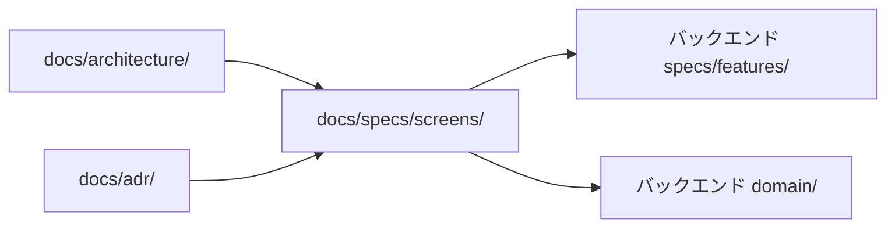

---
paths:
  - 'docs/**'
---

# ドキュメント

`docs/` の書き方を定める。前提として、業務知識とシステム仕様を混ぜない。フロントエンドはこれに加えて、画面の仕様と API の仕様を混ぜない。

## 置き場の役割

| 置き場               | 内容                             | 文の主語 | 直すとき                     |
| -------------------- | -------------------------------- | -------- | ---------------------------- |
| `docs/specs/`        | 画面の振る舞い・状態・遷移       | システム | 上書き                       |
| `docs/architecture/` | 技術構成・実装の構成・規約の検査 | システム | 上書き                       |
| `docs/adr/`          | フロントエンドの意思決定の記録   | —        | 追記のみ。過去は書き換えない |

業務知識（用語集・業務ルール・未確定事項）はこのリポジトリに置かない。バックエンドの `docs/domain/` を唯一の正とする。フロントエンドの作業中に業務ルールが判明したときも、バックエンドの `docs/domain/` へ書く。バックエンドの `docs/` の場所は `scripts/run node scripts/backend-docs.mjs` で引ける。

作業中のプランは `.claude/plans/` に置き、`docs/` には置かない。書き方の規約は `.claude/rules/` に置く。

## どこに書くかを決める

```
0. その主題は既にどこかに書かれているか（両リポジトリで grep -rn して確かめる）
     ├─ はい → その記述を上書きし、ID は維持する。ここで終了
     └─ いいえ ↓
1. 主語は「システム」か
     ├─ いいえ → 業務知識。バックエンドの docs/domain/ に書く
     └─ はい ↓
2. 画面がなくても成り立つ振る舞いか（API を直接呼んでも同じ結果になるか）
     ├─ はい → API の仕様。バックエンドの docs/specs/features/ に書く
     └─ いいえ ↓
3. 複数の画面に共通する振る舞いか
     ├─ はい → docs/specs/screens/conventions.md
     └─ いいえ → docs/specs/screens/<画面>.md
```

2 の判定が最も取り違えやすい。「期限切れの受講は受講状況を記録できない」は API の仕様であり、画面はその結果を表示するだけである。画面仕様には「期限切れの受講では記録の操作を出さない」のように、画面が何を表示し、どう操作させるかだけを書き、根拠を `AC-ENROLL-NNN` で参照する。

画面仕様に書かないものは次のとおりである。

| 書かないもの                     | 担当               |
| -------------------------------- | ------------------ |
| レイアウト・余白・色・部品の並び | デザイン（Figma）  |
| 型・桁数・単なる入力必須         | zod のスキーマ     |
| 応答に含まれる項目の一覧         | バックエンドの API |

受け入れ基準は「〜のとき、システムは〜しなければならない」の形で、1つの基準に1つの振る舞いを書く。画面仕様には「対象外」の節を置き、この画面でやらないことを書く。未確定のまま進める点は `Q-NNN` を参照して明示する。

次の点は書かないと実装が勝手に決めてしまう。その画面に当たるものは必ず書く。

- 検索・並び替え・ページングを API で行うか、画面で行うか
- 複数の検索条件を AND と OR のどちらで結ぶか。テキストの検索は部分一致か完全一致か
- 絞り込みや並び順の既定値
- 区分（受講生・講師・マネージャー）による表示の違い

画面仕様の雛形は `docs/specs/screens/template.md`、全画面に共通する仕様の雛形は `docs/specs/screens/conventions-template.md` にある。画面仕様がまだない画面を触ったときは、今回変えた振る舞いと、テストで確かめた振る舞いだけを書き起こす。画面の全部を推測で埋めない。

## ID

| 対象                       | 形式                     | 置き場                              |
| -------------------------- | ------------------------ | ----------------------------------- |
| 画面の受け入れ基準         | `AC-<画面の略称>-<連番>` | `docs/specs/screens/`               |
| 画面に共通する受け入れ基準 | `AC-SCREEN-<連番>`       | `docs/specs/screens/conventions.md` |
| 意思決定記録               | `ADR-FE-<連番>`          | `docs/adr/`                         |

- 画面の略称はバックエンドの機能の略称（`COMMON`・`AUTHZ`・`ACCOUNT`・`AUTHOR`・`ENROLL`・`PROG`・`ANALYTICS`・`NOTIF`・`TAG`）と重ねない。重ねると、ID を見てどちらのリポジトリを引けばよいか決められなくなる。画面の略称の一覧は `docs/specs/README.md` にある
- 番号は振り直さない。削除したときは欠番のまま空け、なぜ欠番になったかをコメントで残す。その ID を参照している箇所を両リポジトリで `grep -rn` して張り替える。追加は末尾に続ける
- 既存の主題を書き直すときは、新しい ID を振らずにその記述を上書きする
- 存在しない ID を参照しない（CHK-DOC-04）

## 参照の向き



画面仕様からバックエンドの仕様を参照する。逆は持たせない。バックエンドの文書が画面の都合で書き換わらないようにするためである。

画面仕様から業務ルール（`BR-SHARED-NNN`）を直接参照するのは、その画面だけの扱いのときに限る。API の仕様に実体があるなら `AC-<機能>-NNN` を参照する。

## 実装の名前を出す範囲

クラス名・部品名・ファイルパスは、`docs/architecture/` と `docs/adr/` にだけ出す。`docs/specs/` には出さない。画面仕様は業務側と共有するので、画面の名前と利用者の言葉で書く。

## 用語と文体

用語はバックエンドの `docs/domain/shared/glossary.md` を唯一の正とする。画面に表示する文言も同じ用語を使う。

| 使う         | 使わない           |
| ------------ | ------------------ |
| 講座         | コース             |
| チャプター   | 章・セクション     |
| レッスン     | 単元               |
| 受講状況     | 学習進捗・出席状況 |
| 受講生       | 生徒・ユーザー     |
| マネージャー | 管理者             |

- である調で書く。一度読んで意味が取れる、簡潔な説明にする
- 太字記法と区切り線を使わない。強調は見出しと表で表す（CHK-DOC-07）
- 図は mermaid で描く。画面遷移と状態の遷移は必ず mermaid で表す
- 版を分けたファイル（`*_v2.md`・`*_old.md`・`*_20260928.md`）を作らない。状態を表す文書は上書きし、履歴は Git に任せる（CHK-DOC-08）

## 実装が終わったとき

まず、その主題がすでにどこに書かれているかを検索で確かめる。既存の記述があれば ID を維持して上書きし、新しい主題のときだけ新しい番号を末尾に続ける。

そのうえで、同じ変更のなかで次を更新する。

| 変更内容                       | 更新するファイル                                                                                  |
| ------------------------------ | ------------------------------------------------------------------------------------------------- |
| 画面の振る舞いを変えた         | `docs/specs/screens/<画面>.md`（上書き。なければ書き起こす）                                      |
| 画面を足した                   | `docs/specs/screens/<画面>.md` と `docs/specs/README.md` の一覧と略称                             |
| 全画面に共通する扱いを変えた   | `docs/specs/screens/conventions.md`（上書き）                                                     |
| 実装の構成を変えた             | `docs/architecture/overview.md`（上書き）                                                         |
| 規約を変えた                   | `.claude/rules/` の該当ファイルと `docs/architecture/convention-checks.md`                        |
| 技術選定の判断をした           | `docs/adr/` に新しい記録を追加（既存は上書きしない）                                              |
| 業務ルールが判明・変更された   | バックエンドの `docs/domain/shared/business-rules.md`                                             |
| 未確定のまま進める点がある     | バックエンドの `docs/domain/open-questions.md` に `Q-NNN` を追加し、コードに `TODO(Q-NNN)` を残す |
| API に求める振る舞いが変わった | バックエンドで変更する。フロントエンドの変更の中で API の仕様を書き換えない                       |

本文を直したら、同じファイルの図が古いまま残っていないかを見る。不要になった文書は残さず削除する。
