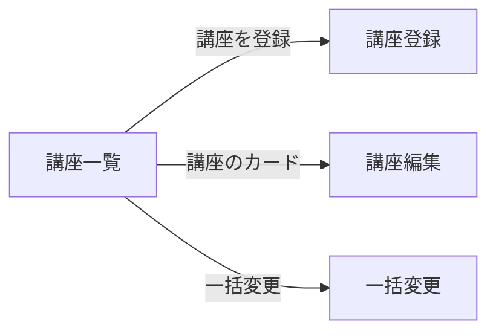

# 講師側 講座一覧

## 目的と利用者

講師が自分の講座を一覧し、検索・分類表示・ページネーションを使って対象講座を確認するための画面である。今回の実装では、バックエンドの `GET /v1/instructor/courses/index` を利用し、表示は実APIの応答を基にする。

## 関連コンテキスト

`shared`（ここでの「タグ」は講師が自分で作る講座の分類ラベルであり、画面では「分類」と表示する）

## パス

`/instructor/courses`

## 表示項目

講座は1件を1枚のカードで表示する。

| 項目     | 表示                                                                                                      |
| -------- | --------------------------------------------------------------------------------------------------------- |
| 講座名   | そのまま表示する                                                                                          |
| 受講期限 | API の `course_deadline` を使い、固定期限は `YYYY/MM/DDまで`、相対期限は `開始日からN日後` として表示する |
| 受講中   | API の `has_active_students` を基に、受講中の講座に印を出す                                               |
| 画像     | 画像URLは API からのフルURLをそのまま使い、UI 側で `NEXT_PUBLIC_STORAGE_URL` を結合しない                 |
| 分類     | 講座に付いているタグの名前を表示する。複数タグがあればそれぞれ表示する                                    |
| 定員     | 表示しない。JKA-1814 では対象外とする                                                                     |
| 検索欄   | プレースホルダーは `講座名・分類名で検索` と表示する                                                      |

## 受け入れ基準

1. `AC-ICLIST-001` 画面は `GET /v1/instructor/courses/index` から講座一覧を取得し、取得した講座を一覧に表示しなければならない。
2. `AC-ICLIST-002` 講座検索は、入力中の検索語を即座に API へ送らず、Enter を押下した時点で `search_word` として API 取得条件へ渡し、検索に一致する講座だけを表示しなければならない。英字の大文字と小文字は区別しない。
3. `AC-ICLIST-003` 検索語が確定したとき、システムはページ番号を 1 に戻し、1ページ目の検索結果を表示しなければならない。
4. `AC-ICLIST-004` 分類表示が有効のとき、システムは現在のページ内にある講座を `tags` でグループ化し、各分類ごとの見出しで表示しなければならない。
5. `AC-ICLIST-005` 複数タグを持つ講座は、それぞれのタグ見出しに表示されなければならない。
6. `AC-ICLIST-006` タグのない講座は「未分類」としてまとめて表示しなければならない。
7. `AC-ICLIST-007` ページネーションは API の `meta.current_page` と `meta.last_page` を使い、ページ移動時に page を API 取得条件へ反映しなければならない。
8. `AC-ICLIST-008` 画像は API が返した完成済みの URL を使って表示し、UI 側で `NEXT_PUBLIC_STORAGE_URL` との結合を行ってはならない。
9. `AC-ICLIST-009` 画面は定員・受講人数の表示を行わず、JKA-1814 の対象外として扱わなければならない。
10. `AC-ICLIST-010` 検索結果が 0 件のときは、「該当する講座はありません。」と表示しなければならない。
11. `AC-ICLIST-011` API 取得に失敗したときは、利用者に取得失敗の状態を示す。画面の文言は既存仕様で定めず、画面として分かる簡潔なメッセージとする。
12. `AC-ICLIST-012` 検索欄のプレースホルダーは `講座名・分類名で検索` と表示しなければならない。

## 状態別の挙動

| 状態       | 表示                                                            |
| ---------- | --------------------------------------------------------------- |
| 0件        | 「該当する講座はありません。」を出す                            |
| 読み込み中 | Suspense によるローディング表示を使う。画面固有の文言は決めない |
| エラー     | ErrorBoundary のフォールバックで、取得失敗の状態を示す          |

## 画面遷移

遷移先の画面はまだない。

## 対象外

- `GET /v1/instructor/courses/tags/index` の利用
- 定員・受講人数の表示追加
- `capacity` / `attendances_count` を一覧APIへ追加するバックエンド変更
- JKA-1867 / JKA-1868 の対応
- 既存の画面仕様にない独自の文言や見た目の追加
