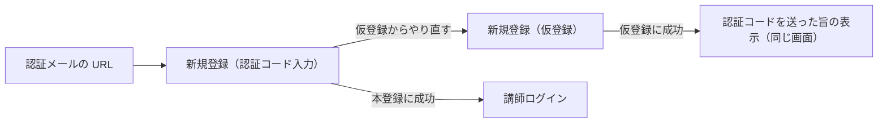

# 講師側 新規登録（仮登録）・新規登録（認証コード入力）

## 目的と利用者

講師が自分で新規登録するための画面である。仮登録で講師名・姓・名・メールアドレスを受け付け、メールで届いた認証コードとパスワードで本登録する。マネージャーが講師を登録した場合も同じメールが届き、認証コード入力の画面で本登録する。

## 関連コンテキスト

`shared`（仮登録は講師本人が手続きを始めた登録であり、どのマネージャーの配下にも入らない。AC-ACCOUNT-018）

## パス

| 画面                       | パス                               |
| -------------------------- | ---------------------------------- |
| 新規登録（仮登録）         | `/instructor/signup`               |
| 新規登録（認証コード入力） | `/instructor/verification/<token>` |

## 表示項目

| 項目                     | 新規登録（仮登録）                                                        | 新規登録（認証コード入力）                                           |
| ------------------------ | ------------------------------------------------------------------------- | -------------------------------------------------------------------- |
| 見出し                   | 「新規登録画面」                                                          | 「新規登録画面」                                                     |
| 案内文                   | 仮登録に成功した後に「<メールアドレス> 宛てに認証コードを送信しました。」 | 認証コードを送付した旨と、認証コードの入力とパスワードの設定を促す文 |
| 入力欄                   | 講師名・姓・名・メールアドレス（AC-ACCOUNT-002）                          | 認証コード・パスワード・パスワード再入力（AC-ACCOUNT-010）           |
| 送信のボタン             | 「登録」。送信中は「登録中...」                                           | 「登録」。送信中は「登録中...」                                      |
| 送信の失敗の枠           | フォームの上に置く                                                        | フォームの上に置く                                                   |
| 仮登録からやり直すリンク | 出さない                                                                  | 仮登録からやり直す必要があるとき、送信の失敗の枠の中に出す           |

## 受け入れ基準

1. `AC-ISIGNUP-001` 仮登録の入力が検証を通らないとき、システムは登録を実行せず、理由を該当する入力欄の下に表示しなければならない。
2. `AC-ISIGNUP-002` 仮登録で、検証を通った入力で登録が押されたとき、システムは入力値で仮登録を実行しなければならない。仮登録に成功したときだけ、フォームに代えて、入力したメールアドレスに認証コードを送った旨を表示する。
3. `AC-ISIGNUP-003` 認証コード入力の入力が検証を通らないとき、システムは登録を実行せず、理由を該当する入力欄の下に表示しなければならない。パスワード再入力がパスワードと一致しないときは、パスワード再入力の入力欄の下に表示する（AC-ACCOUNT-011）。
4. `AC-ISIGNUP-004` 認証コード入力で、検証を通った入力で登録が押されたとき、システムは URL の token と入力値で本登録を実行しなければならない。認証コードは大文字と小文字を区別して照合されるため、前後の空白だけを落とし、文字の種類を絞らず、大文字にも小文字にも変えない。
5. `AC-ISIGNUP-005` システムは URL の token を画面に表示してはならない。
6. `AC-ISIGNUP-006` システムは、パスワードとパスワード再入力に入力された文字を伏せて表示しなければならない。
7. `AC-ISIGNUP-007` サーバーが入力の項目ごとの誤りを返したとき、システムは理由を該当する入力欄の下にだけ表示し、フォームの上の枠には表示してはならない。メールアドレスがすでに講師として登録されているときは「このメールアドレスはすでに登録されています」と表示する。
8. `AC-ISIGNUP-008` 送信がそのほかの理由で失敗したとき、システムは「送信の失敗の表示」の表の文言をフォームの上の枠に表示し、画面に留まらなければならない。サーバーが返した message は表示しない。
9. `AC-ISIGNUP-009` 認証コードの誤りが上限を超えたとき、有効期限が切れたとき、URL の仮登録が見つからないとき、システムは失敗の文言とともに、仮登録の画面へ移る「仮登録からやり直す」リンクを表示しなければならない。認証コードが一致しないときは表示しない。
10. `AC-ISIGNUP-010` 本登録に成功したとき、システムは講師ログインの画面へ移り、本登録が完了した旨の案内を表示しなければならない。本登録の成功から移ってきたのでないときは、案内を表示しない。
11. `AC-ISIGNUP-011` 送信中、システムは登録のボタンを押せなくし、「登録中...」と表示しなければならない。

## 送信の失敗の表示

| 画面           | 場面                                              | 文言                                                                                                               | 仮登録からやり直すリンク |
| -------------- | ------------------------------------------------- | ------------------------------------------------------------------------------------------------------------------ | ------------------------ |
| 仮登録         | 認証コードか token を作れなかった、そのほかの失敗 | 仮登録に失敗しました                                                                                               | なし                     |
| 仮登録         | メールアドレスがすでに講師として登録されている    | このメールアドレスはすでに登録されています（メールアドレスの欄の下に出す）                                         | なし                     |
| 認証コード入力 | 認証コードが一致しない                            | 認証コードが正しくありません。メールに記載の認証コードを確かめて、もう一度入力してください                         | なし                     |
| 認証コード入力 | 誤りが上限を超えた                                | 認証コードの誤りが上限を超えたため、この仮登録は無効になりました。お手数ですが、仮登録からやり直してください       | あり                     |
| 認証コード入力 | 有効期限が切れた                                  | 認証コードの有効期限（60分）が切れたため、この仮登録は無効になりました。お手数ですが、仮登録からやり直してください | あり                     |
| 認証コード入力 | 仮登録が見つからない、URL の token が誤っている   | この URL の仮登録が見つかりません。無効になったか、URL が誤っている可能性があります。仮登録からやり直してください  | あり                     |
| 認証コード入力 | そのほかの失敗                                    | 本登録に失敗しました                                                                                               | なし                     |
| 両方           | 通信と関係のない予期しない失敗                    | 予期しないエラーが発生しました                                                                                     | なし                     |

講師ログインの画面に出す案内は「本登録が完了しました。登録したメールアドレスとパスワードでログインしてください。」とする。

## 状態別の挙動

| 状態       | 表示                                                                                                     |
| ---------- | -------------------------------------------------------------------------------------------------------- |
| 送信中     | 登録のボタンを押せなくし、「登録中...」と表示する                                                        |
| 読み込み中 | 生じない。画面を開くときに取得するデータがない                                                           |
| エラー     | 項目ごとの誤りは入力欄の下に、そのほかの失敗はフォームの上の枠に出す。文言は「送信の失敗の表示」のとおり |

## 画面遷移

## 対象外

- ほかの画面から仮登録の画面への導線。今は URL を直接開く
- 認証メールの URL をこの画面へ向けること（バックエンド）。今のメールには受講生と共通の URL が書かれる
- マネージャーが講師を登録する画面
- 受講生側の認証コード入力画面
