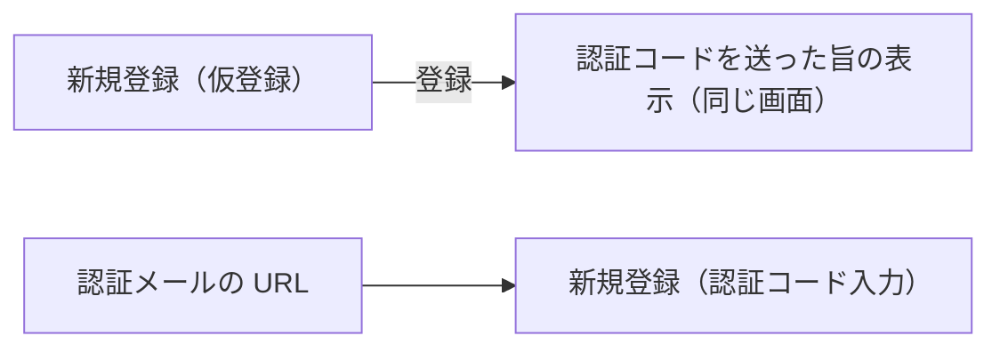

# 講師側 新規登録（仮登録）・新規登録（認証コード入力）

## 目的と利用者

講師が自分で新規登録するための画面である。仮登録で講師名・姓・名・メールアドレスを受け付け、メールで届いた認証コードとパスワードで本登録する。マネージャーが講師を登録した場合も同じメールが届き、認証コード入力の画面で本登録する。

## 関連コンテキスト

`shared`（仮登録は講師本人が手続きを始めた登録であり、どのマネージャーの配下にも入らない。AC-ACCOUNT-018）

## パス

| 画面                       | パス                               |
| -------------------------- | ---------------------------------- |
| 新規登録（仮登録）         | `/instructor/signup`               |
| 新規登録（認証コード入力） | `/instructor/verification/<token>` |

## 表示項目

| 項目           | 新規登録（仮登録）                                              | 新規登録（認証コード入力）                                           |
| -------------- | --------------------------------------------------------------- | -------------------------------------------------------------------- |
| 見出し         | 「新規登録画面」                                                | 「新規登録画面」                                                     |
| 案内文         | 登録の後に「<メールアドレス> 宛てに認証コードを送信しました。」 | 認証コードを送付した旨と、認証コードの入力とパスワードの設定を促す文 |
| 入力欄         | 講師名・姓・名・メールアドレス（AC-ACCOUNT-002）                | 認証コード・パスワード・パスワード再入力（AC-ACCOUNT-010）           |
| 送信のボタン   | 「登録」                                                        | 「登録」                                                             |
| 送信の失敗の枠 | フォームの上に置く                                              | フォームの上に置く                                                   |

## 受け入れ基準

1. `AC-ISIGNUP-001` 仮登録の入力が検証を通らないとき、システムは登録を実行せず、理由を該当する入力欄の下に表示しなければならない。
2. `AC-ISIGNUP-002` 仮登録で、検証を通った入力で登録が押されたとき、システムは入力値で登録を実行し、フォームに代えて、入力したメールアドレスに認証コードを送った旨を表示しなければならない。
3. `AC-ISIGNUP-003` 認証コード入力の入力が検証を通らないとき、システムは登録を実行せず、理由を該当する入力欄の下に表示しなければならない。パスワード再入力がパスワードと一致しないときは、パスワード再入力の入力欄の下に表示する（AC-ACCOUNT-011）。
4. `AC-ISIGNUP-004` 認証コード入力で、検証を通った入力で登録が押されたとき、システムは URL の token と入力値で登録を実行しなければならない。認証コードは大文字と小文字を区別して照合されるため、前後の空白だけを落とし、文字の種類を絞らず、大文字にも小文字にも変えない。
5. `AC-ISIGNUP-005` システムは URL の token を画面に表示してはならない。
6. `AC-ISIGNUP-006` システムは、パスワードとパスワード再入力に入力された文字を伏せて表示しなければならない。

## 状態別の挙動

| 状態       | 表示                                                                 |
| ---------- | -------------------------------------------------------------------- |
| 送信中     | API とつなぐまでは生じない。扱いは API 連携の Issue で決める         |
| 読み込み中 | 生じない。画面を開くときに取得するデータがない                       |
| エラー     | 送信の失敗はフォームの上の枠に出す。文言は API 連携の Issue で決める |

## 画面遷移

本登録が成功したあとの遷移は、API 連携の Issue で決める。

## 対象外

- ほかの画面から仮登録の画面への導線。今は URL を直接開く
- API との連携。続きの Issue で扱う
- 認証メールの URL をこの画面へ向けること（バックエンド）。今のメールには受講生と共通の URL が書かれる
- マネージャーが講師を登録する画面
- 受講生側の認証コード入力画面
