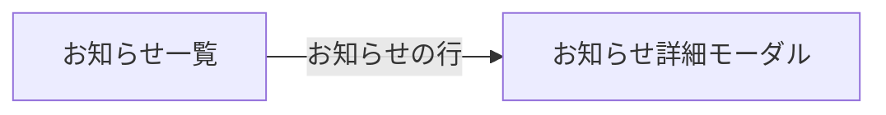

# 受講生側 お知らせ一覧

## 目的と利用者

受講生が、受講している講座のお知らせを一覧し、選んだお知らせの本文を読むための画面である。

## 関連コンテキスト

`shared`（ここでの「お知らせ」は、講師が講座の受講生に向けて出すお知らせである。一覧に出すお知らせの範囲は、バックエンドの AC-NOTIF-014 に従う）

## パス

`/notifications`

## 表示項目

お知らせは1件を表の1行で表示する。

| 項目     | 表示                                           |
| -------- | ---------------------------------------------- |
| タイトル | そのまま表示する                               |
| 講座名   | そのまま表示する                               |
| 開始日付 | 掲示を始める日時を「2026/10/07」の形で表示する |

行を押すと、お知らせの詳細をモーダルで表示する。

| 項目     | 表示                    |
| -------- | ----------------------- |
| 講座名   | 「お知らせ：講座名」    |
| 受講期限 | 今は常に「—」を表示する |
| タイトル | そのまま表示する        |
| 本文     | 改行を保って表示する    |

## 受け入れ基準

1. `AC-SNLIST-001` 初期表示のとき、システムはお知らせを開始日付の新しい順に、1ページ5件ずつ表示しなければならない。
2. `AC-SNLIST-002` タイトル・講座名・開始日付の並び替えのボタンが押されたとき、システムはその列の昇順で1ページ目から表示しなければならない。講座名は講座の登録順に並べ、講座名の文字の順にはしない。
3. `AC-SNLIST-003` 並び替えている列のボタンがもう一度押されたとき、システムは昇順と降順を入れ替えて1ページ目から表示しなければならない。
4. `AC-SNLIST-004` 並び替えとページの分割はサーバー側で処理しなければならない（取得したページの中だけで並べ替えない）。
5. `AC-SNLIST-005` システムは、並び替えている列にだけ昇順か降順かの向きを示し、ほかの列には向きのない印を示さなければならない。
6. `AC-SNLIST-006` ページ番号が押されたとき、システムはそのページのお知らせを表示しなければならない。
7. `AC-SNLIST-007` お知らせが減るなどして表示中のページがなくなったとき、システムは最後のページを表示し直さなければならない。
8. `AC-SNLIST-008` お知らせの行が押されたとき、またはキーボードで行を選んで Enter か Space が押されたとき、システムはそのお知らせの詳細をモーダルで表示しなければならない。
9. `AC-SNLIST-009` 詳細のモーダルが閉じられたとき、システムは開いたときのお知らせの行にフォーカスを戻さなければならない。

## 状態別の挙動

| 状態             | 表示                                                               |
| ---------------- | ------------------------------------------------------------------ |
| 0件              | 「現在、お知らせはありません。」を出す。表とページ送りは出さない   |
| 読み込み中       | 表の見出しと5件分の行のスケルトンを出す                            |
| エラー           | 「エラーが発生しました」を出す                                     |
| 取り直している間 | ページの切り替えと並び替えでは、取り直す前の一覧を出したままにする |

## 画面遷移

受講生のヘッダーのメニューからの導線はまだない（JKA-1859）。

## 対象外

- 受講期限の表示。一覧の API が受講期限を返さないため、一覧には列を出さない。詳細のモーダルの受講期限は、詳細の API につなぐときに表示する（JKA-1810）
- 既読の登録。モーダルを開いたときは、実行の記録だけを行う（JKA-1810）
- 既読・未読の表示と、講師の呼び名・既読状態での並び替え
